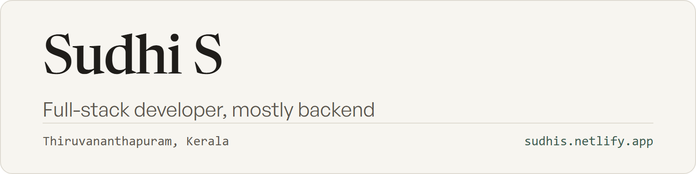
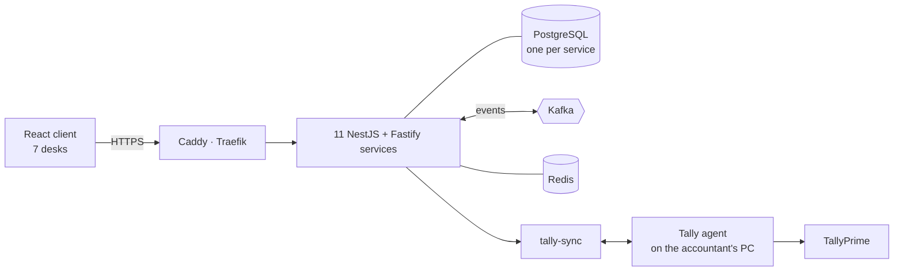
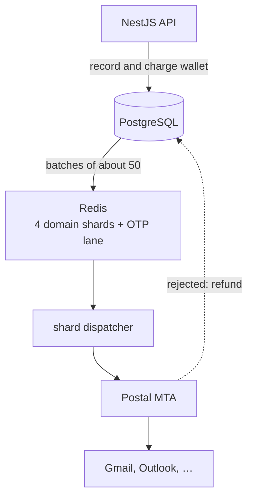
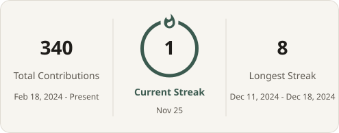

<picture>
  <source media="(prefers-color-scheme: dark)" srcset="assets/banner-dark.png">
  
</picture>

### Hi, I'm Sudhi

I'm a full-stack developer in Thiruvananthapuram, Kerala. Most of my time goes into the backend: services that pass
work through queues, Postgres schemas that keep orders, stock and money correct, and the deploy setup that keeps it all
running. I build the React screens on top as well. I've been at Oxium Technologies since June 2025.

> [!NOTE]
> **Open to work:** backend-leaning full-stack roles, remote or in Kerala. The quickest way to reach me is
> [my site](https://sudhis.netlify.app/contact).

#### What I'm working on

- **A distribution ERP for a food wholesaler** (client project at Oxium). Eleven NestJS services, each with its own
  PostgreSQL database, talking over Kafka; a keyboard-first React client with seven desks for billing, purchase,
  warehouse, dispatch and management; GST e-invoicing; and a connector that keeps TallyPrime in sync. Staging runs on
  k3s with Argo CD. The code is private, so I wrote it up [on my site](https://sudhis.netlify.app/work/distribution-erp).
- **[DispatchHub](https://github.com/Sudhi-S-2003/DispatchHub)**, a self-hosted email platform on top of Postal.
  Tenants verify their own sending domains, mail moves through sharded Redis queues with a fast lane for OTPs, and each
  send is paid for up front and refunded automatically if the mail server rejects it.

<b>How the ERP fits together</b>

 

Each service owns its data, so one desk's heavy query never locks another desk's tables, and every rule that crosses
desks goes through an API I can test. Writes to Tally are queued, read back, and compared every night.

<b>How DispatchHub moves a message</b>

 

The backlog lives in Postgres, so Redis stays small during a big campaign, and a slow provider only holds up its own
shard.

#### Things I've built

| Project | What it is | Built with |
| :--- | :--- | :--- |
| [DispatchHub](https://github.com/Sudhi-S-2003/DispatchHub) | Multi-tenant email delivery: per-domain DKIM keys, live DNS checks, four queue shards and a priority lane | NestJS, Next.js, PostgreSQL, Redis, BullMQ |
| [ApiForge](https://github.com/Sudhi-S-2003/ApiForge) | API contracts, docs and testing in one place, with OpenAPI 3.1 and Postman import and export. Early: design docs first, code catching up | NestJS, Prisma, Next.js, Monaco |
| [movie_booking](https://github.com/Sudhi-S-2003/movie_booking) | Began as cinema seat booking and became where I try hard problems: real-time chat, passkey sign-in, 2FA, and a Git-like code-sharing service | TypeScript, Express, MongoDB, Redis, Socket.io, React |
| [Portfolio](https://github.com/Sudhi-S-2003/Portfolio) | My site, in English, Malayalam and Hindi, with a contact form that still reaches me when the chat server is down | React, Vite, i18next, Netlify |

#### On GitHub

  <picture>
    <source media="(prefers-color-scheme: dark)" srcset="assets/stats-dark.svg">
    
  </picture>
  <picture>
    <source media="(prefers-color-scheme: dark)" srcset="assets/streak-dark.svg">
    
  </picture>

Most of my day-to-day work lives in private client repositories, so these show only part of it. The cards are
rebuilt every day by a workflow in this repo.

#### Tools I reach for

**Backend** · Node.js, TypeScript, NestJS, Express, Prisma 
**Data** · PostgreSQL, MongoDB, Redis, Kafka, BullMQ 
**Frontend** · React, Next.js, TanStack Query, Tailwind CSS 
**Running it** · Docker, Kubernetes (k3s), Argo CD, Traefik, Caddy

I use AI coding assistants to move faster on UI work and boilerplate. The architecture, data models and backend logic
are my own, and I review every line before it ships.

#### Get in touch

[sudhis.netlify.app](https://sudhis.netlify.app) · [LinkedIn](https://www.linkedin.com/in/sudhi-s-a2a4ab30b) ·
[sudhiselampa19@gmail.com](mailto:sudhiselampa19@gmail.com)
